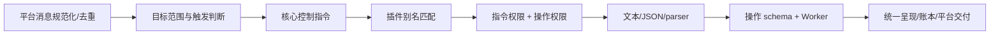

# 触发、指令与路由

## 入口选择

| 形式              | 声明/使用方法                           | 谁执行                                                      |
| ----------------- | --------------------------------------- | ----------------------------------------------------------- |
| 模型工具          | operation.tool=true                     | Pi 选择已装载且获准的工具，Bot 转为 Worker RPC              |
| 直接指令          | commands 绑定 operation                 | Bot 解析并鉴权，直接调用，不必调用模型                      |
| 回复/上下文处理   | hooks 绑定核心 point                    | Bot 在固定切入点调用，处理器不抢整个消息总线                |
| 普通消息/回执观察 | observe handler                         | 持久 outbox + 独立 durable 观察任务                         |
| 计划任务          | 用户创建 Bot Cron，提示中选用相应能力   | 进入同一协调器和 Agent/Job；插件没有自注册 Cron 的 manifest |
| 后台操作          | operation.execution=background          | Bot Job 管理提交、轮询、取消与结果交付                      |
| 插件协作          | 显式依赖 + operation RPC / 自定义 point | Core 保留原触发身份与范围                                   |

## QQ 与 Mock 的路由

QQ 必须先选中测试目标。未启用群只做会话发现；连接成功不自动允许回复。自身消息不触发模型，撤回来源不会重新载入。

普通 QQ 消息先记录和通知可用消息观察器；匹配内置/已登记插件指令、`!pi 内容` 或 `@Bot 内容` 才进入工作。配置可替换 `!pi` 前缀，前缀后要求空白边界。注册后可直接发送 `/状态 --text`，也可用前缀或 @ 后带指令。别名尚未注册、实例停用、范围没选择或后端关闭时，不要依赖裸指令触发模型来“补救”。

Mock/Web 消息直接进入协调器。已知指令先处理；未知斜杠文本在 Agent 开启时可能继续作为 Agent 请求，关闭时返回对应提示。测试指令路由应使用明确登记的别名，而不是只观察有没有一条回复。

核心控制指令先于插件：`/help`、`/status`、`/stop`、`/new`、`/skills`、`/skill`、`/jobs`、`/job`。这些名字保留，插件注册会拒绝冲突。`/status` 表示 Bot 当前会话状态；系统状态迁移插件使用 `/状态` 和 `/sysstatus`。

插件命令匹配 `/名称` 或 `/名称 空白 参数`，大小写归一，中文别名可用；名称只允许字母/数字/下划线/连字符，最长 40 位。不能把 `voice on` 当作包含空格的别名，子命令应交给 parser。多个插件占用同一别名会在配置校验时拒绝，不按安装顺序抢占。

## 三种内置参数方式

```json
{
  "id": "echo",
  "names": ["echo"],
  "operation": "echo",
  "arguments": "text",
  "textField": "text",
  "description": "文本参数"
}
```

- text：默认方式，`/echo hello world` → `{ "text": "hello world" }`，textField 可换成业务字段。
- json：整个剩余文本解析成 JSON 对象；空参数为 `{}`，不能传任意非对象数据。
- none：传 `{}`，有额外参数时明确失败。

操作仍由 inputSchema 校验。`/draw { ... }` 是 JSON 模式指令，不是绕过参数 schema 的另一个工具。

## 自定义解析与子命令

manifest：

```json
{
  "id": "status",
  "names": ["状态", "sysstatus"],
  "operation": "inspect",
  "description": "查看系统状态",
  "parser": "status_args"
}
```

代码：

```ts
import { definePlugin } from '@pi-im-bot/plugin-sdk'
import { z } from 'zod'

const InputSchema = z.object({ format: z.enum(['text', 'json']) })

export default definePlugin({
  parsers: {
    status_args({ text }) {
      if (text.trim() === '--json') {
        return { format: 'json' }
      }
      if (text.trim() === '') {
        return { format: 'text' }
      }
      throw new Error('用法：/状态 [--json]')
    }
  },
  operations: {
    inspect(input) {
      const args = InputSchema.parse(input)
      return { text: args.format }
    }
  }
})
```

parser 接收 `{text}`，返回 JSON 对象；声明 parser 后优先使用它。parser 运行于隔离 Worker，没有额外宿主 grants，不应发消息、提交任务或修改业务状态。解析成功后仍校验 operation 输入；不要接受传入的 actorId、groupId 或 role 来替换可信调用上下文。

## 完整路由与权限链



能力 ID 分别是 `command:plugin:<实例>/<command.id>` 和 `plugin:<实例>/<operation.id>`，两项都必须获准；允许指令不等于允许其业务操作。Hook 独立使用 `hook:plugin:<实例>/<handler.id>`。MCP、Skill、工具集合和额外动作权限会继续收窄执行。

`/help` 只列出获准的插件指令。群 Agent 关闭不影响已授权的直接插件指令。业务失败作为本次指令失败处理，不偷偷再调用 LLM；前台结果统一进入呈现和发送，插件通常直接 return，不调用额外发送来重复回复。

`context.invocation.origin` 是可信来源类别（im/command/schedule/job/tool/admin），actors 保留触发者。它们用于追踪和选择器，不能取代核心权限检查。多人合批时权限取交集，某一成员的权限不会留给下一位成员使用。
